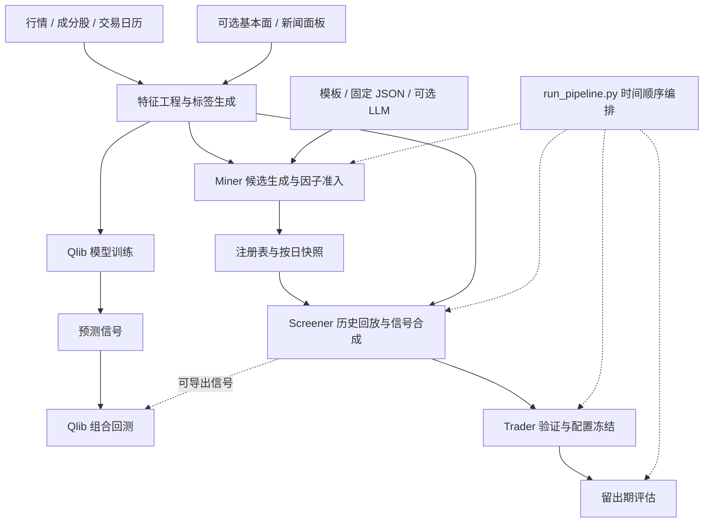

# 项目架构

本项目是围绕 AlphaCrafter 论文开展的 Python 量化研究工程。当前组织方式是命令行脚本、共享计算函数和文件化实验产物，没有独立的 Web 服务、数据库服务或券商执行服务。

本文描述当前代码结构；实验结论、参数和收益以各实验文档及对应产物为准。

## 1. 总体结构



两条主要路线共享行情、特征面板和部分评估代码，但并不是同一套训练或交易流程：

- **模型基线**：技术特征 → Qlib/XGBoost → 预测 → Qlib 持仓回测。
- **AlphaCrafter 主线**：候选因子 → Miner 准入 → 因子快照 → Screener 动态筛选 → Trader 策略验证与留出评估。

CSI300、中低频持仓及 Qlib 三组消融是独立研究分支，不应视为已全部接入主线运行器。

## 2. 目录与职责

| 位置 | 职责 | 主要入口 |
|---|---|---|
| `quant-method/machine-learn/` | 数据下载、特征工程、模型基线、Qlib 回测和模型对照实验 | `download_market_data.py`、`build_features.py`、`train_xgboost_qlib.py`、`qlib_portfolio_backtest.py` |
| `quant-method/alphacrafter/` | 因子准入、动态筛选、策略验证、时点控制及研究分支 | `miner_lite.py`、`screener_lite.py`、`trader_lite.py`、`run_pipeline.py` |
| `alphax.factor_dsl` | 共享的因子 JSON 表达式解析、校验与求值 | 安装后直接导入，源码与 AlphaCrafter CLI 同目录 |
| `machine-learn/data/raw/` | 原始行情、成员记录及来源信息 | 下载和导入脚本生成 |
| `machine-learn/data/processed/` | 特征面板、标签结束日、日历及清单 | 特征工程生成 |
| `machine-learn/data/qlib/` | 本地 Qlib provider、模型和实验结果 | 各实验入口生成 |
| 两个代码目录下的 `tests/` | 数据契约、计算逻辑和流程集成测试 | 仓库根目录的 `make test` |
| `docs/alphacrafter/`、`docs/machine-learn/` | 实验记录、指标与数据审计 | 各代码目录的 README 为索引 |

表中的 `machine-learn/data/` 相对于 `quant-method/`。大部分行情、缓存与实验产物被 `.gitignore` 排除，检出代码不代表已具备可运行的数据环境。

## 3. 数据与模型基线

1. `download_market_data.py` 下载 S&P 500 行情；历史成员补充与审计由 `download_historical_member_prices.py`、`audit_sp500_universe.py` 等脚本处理。
2. `build_features.py` 生成股票 × 日期面板，包括技术指标、Alpha158 风格特征、未来收益标签和标签结束日；可通过向后 as-of join 合并带可用日期的基本面与新闻。
3. `data_contract.py` 集中处理特征字段判定、交易日历、标签结束日解析和前瞻收益构造，防止标签及元数据混入模型特征。
4. `train_xgboost_qlib.py` 将面板适配到 Qlib `DatasetH` / `XGBModel`，执行横截面归一化、训练、预测、IC 评价与特征重要性输出。
5. `qlib_portfolio_backtest.py` 将行情转换为本地 Qlib provider，使用 Exchange、SimulatorExecutor 和 TopkDropoutStrategy 评估预测信号。

`run_xgb_*`、`run_market_state_experiment.py`、`run_factor_optimization.py` 等是对照实验入口。`run_qlib_three_way.py` 和 `run_factor_trajectories.py` 则提供 Qlib 官方 Alpha158 特征、LLM 因子及组合的消融和因子研究轨迹。

## 4. AlphaCrafter 核心链路

| 模块 | 输入与职责 | 关键输出 |
|---|---|---|
| `miner_lite.py` | 从模板、固定候选文件或 LLM 获取因子；校验安全 AST、计算因子、归一化、评估多周期指标、准入和到期重验 | `candidate_metrics.csv`、`registry.json`、`factor_library.json`、`snapshots/` |
| `miner_search.py` | 在限定候选预算内，用训练窗口的滚动反馈迭代提案；候选冻结后仍走正式准入 | 搜索反馈和冻结候选 |
| `langgraph_miner.py` | 可选的多 Miner 候选生成 fan-out/fan-in；复用相同校验和准入逻辑 | 去重候选 |
| `screener_lite.py` | 按信号日恢复可见因子库，依据已兑现标签的近期 Rank IC 筛选并合成信号；可选 LLM 状态、相关性和相似性判断 | `predictions.csv`、`selection.csv`、`regime.csv` |
| `trader_lite.py` | 验证显式定义的多空配置，在可行域内选择策略，再评估后续留出期；无可行策略则持有现金 | 持仓、逐日收益、摘要 |
| `run_pipeline.py` | 构建维护计划，以子进程运行 Miner/Screener，并调用 Trader 函数冻结策略和评估留出 | 计划、清单、日志、快照、冻结选择、状态 |

LLM 是候选生成和部分筛选判断的可选组件；默认流程无需调用外部模型。模型返回的是受约束的 JSON/AST，不执行任意生成代码。DeepSeek 使用内置兼容客户端，其他提供商可通过 LiteLLM 接入；LangGraph 只承担候选生成编排。

## 5. 时间隔离与实验状态

`temporal.py` 在共享 `data_contract.py` 之上封装可见面板截断、窗口校验、跨期标签剔除、注册表认证及快照回放。这是 Miner、Screener 和 Trader 共同依赖的基础能力。

主线运行顺序为：

```text
固定输入、候选和维护计划
  → 验证期之前首次因子准入
  → 验证期间按计划维护快照
  → Screener 回放验证期
  → 冻结 Trader 配置
  → 按固定规则维护留出期快照并生成信号
  → 使用冻结配置评估留出期
```

后续维护可以使用当时已经兑现的历史标签。因子训练、因子准入和 Trader 策略验证属于不同决策阶段，不能把同一个“验证集”名称理解为可以重复使用未来信息。

- `as_of` 约束可见数据；跨窗口末尾且尚未兑现的标签被剔除。
- 快照按日期激活，不把最终因子库回填成历史可交易信号。
- `diagnostic_predictions.csv` 是历史回算诊断，不能替代快照回放。
- Pipeline 使用输入、代码及关键产物哈希，保存事件日志与冻结选择。
- 实验使用新输出目录，已提交快照保持只读。显式续跑可复用两期 Miner 轮次、Screener 信号、Trader 冻结决定及已提交的留出评估。
- 读取结果应确认 `status.json` 为 `completed`，不能仅凭部分文件判断成功。

详细时序与产物结构见 [PIPELINE.md](alphacrafter/PIPELINE.md) 和 [TEMPORAL_REPLAY.md](alphacrafter/TEMPORAL_REPLAY.md)。

## 6. CSI300 与中低频研究分支

- `csi300_data.py`：复用技术特征生成逻辑，按成员有效区间构建 CSI300 面板；研究入口为 `run_csi300_research.py`。
- `admission.py`：按周期构建研究候选池，再对冻结组合做策略验证；与严格论文准入路线分别记录。
- `cn_portfolio.py`：持续持仓的只做多研究模拟器，包含隔夜库存卖出约束、佣金、滑点、印花税、调仓和换手/费用预算；入口为 `run_cn_portfolio_research.py`。
- `medium_frequency.py`：5/20 交易日开盘到开盘标签、候选和同周期筛选；`run_medium_frequency.py`、`run_medium_diagnostic.py`、`run_medium_attribution.py` 分别负责研究、诊断和归因。

三种回测执行口径需要分别理解：Qlib 使用自己的持仓与成交模拟；Trader-lite 是 T 收盘信号、T+1 开盘建仓且收盘平仓的日内代理；CN 模拟器维护跨日持仓。不同口径的收益不能直接当作同一策略比较。

## 7. 当前边界与代码组织特点

项目已实现研究链路和时点审计，但尚未复现论文收益，也未连接券商。严格准入允许得出“没有合格因子或策略”的结果；放宽门槛的演示与历史探索不等同于严格流程成功。

S&P 500 主数据仍存在当前成分股快照、历史退出成员及部分数据来源时点的限制。具备时间隔离代码不等于数据本身已经通过 point-in-time 认证。详见 [REPRODUCTION_STATUS.md](alphacrafter/REPRODUCTION_STATUS.md) 与 [DATA_PROVENANCE_AUDIT.md](alphacrafter/DATA_PROVENANCE_AUDIT.md)。

因子 DSL 已抽到共享包 `alphax.factor_dsl`，Miner、Screener 与研究分支共用同一份解析和求值实现。评价指标、CLI、LLM 客户端和注册表维护仍集中在 `miner_lite.py`，部分跨目录依赖通过修改 `sys.path` 实现。后续模块拆分见[工程化规划](ENGINEERING_ROADMAP.md)。

## 8. 阅读与运行入口

建议先读两份 [machine-learn README](../quant-method/machine-learn/README.md) 和 [AlphaCrafter README](../quant-method/alphacrafter/README.md)，再沿 `data_contract.py → build_features.py → temporal.py → miner_lite.py → screener_lite.py → trader_lite.py → run_pipeline.py` 阅读主链路。

检查默认滚动计划：

```bash
python3 quant-method/alphacrafter/run_pipeline.py \
  --output-dir quant-method/machine-learn/data/qlib/architecture_review \
  --dry-run
```

该命令依赖本地特征数据，dry-run 只预检计划，不能替代完整实验。核心回归测试入口：

```bash
make test
```

运行环境以两目录的 `requirements.txt` 和 README 为依据，部分研究脚本还使用额外的模型或数据读取依赖。
